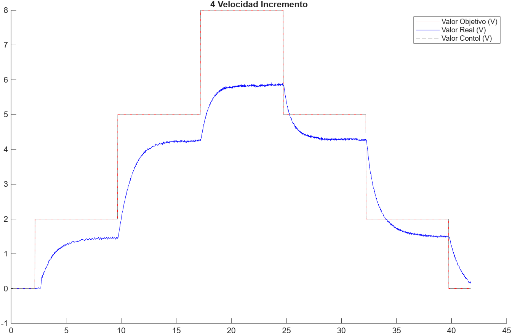
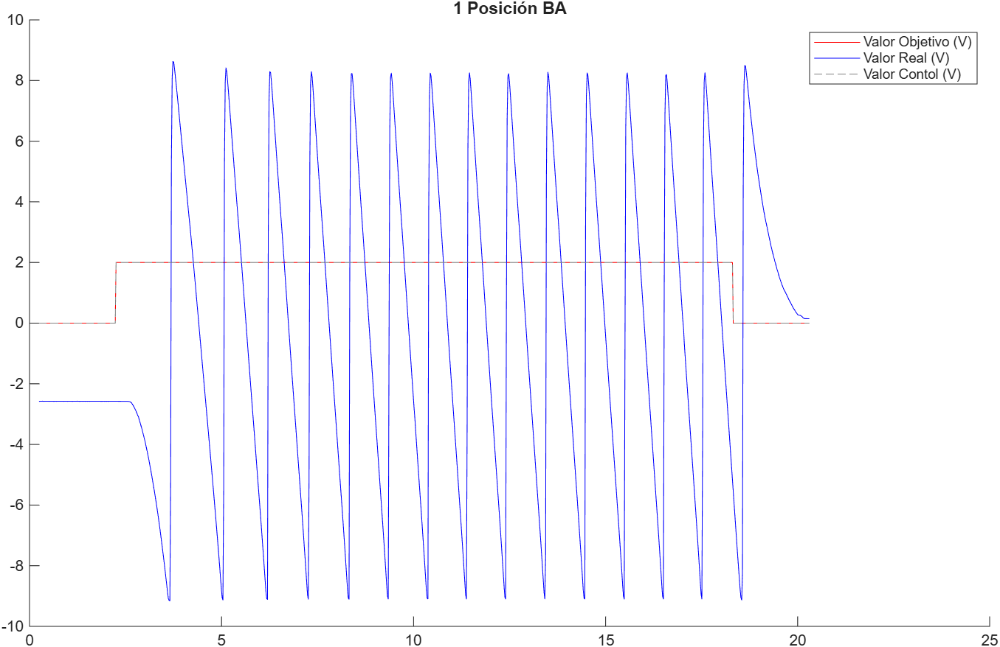

# Modelo Control Motor CC
Se desea crear un modelo de controlador para la velocidad y posición
de un motor de CC en Matlab.

La comunicación entre el ordenador y el motor se realizar empleando
la placa NIDAQ USB y una libreria proporcionada por la
Universidad Politécnica de Valencia. [1]()

El objetivo básico es que cumpla con las siguientes especificaciones:
- Tiempo de establecimiento ≤ 3s (te ≤ 3s)
- Sobre oscilación ≤ 4.3% (δ ≤ 4.3%)
- Error nulo ante referencia escalón (ep = 0)

## Modelado e identificación del motor

Mediante el uso de la función personalizada [`Ensayos(n)`]() siendo
n el tipo de ensayo, se realizan 3 ensayos:

### Ensayo de velocidad 

 

fdsgfsgasdasd

- Ensayo de posición en bucle abierto

 

En el ensayo se aplica una señal de 2V al motor y se obtiende los valores de
la posición.

De la gráfica Posición BA podemos deducir que el comportamiento es de un
sistema de 1º orden con integrador que se puede aproximar mediante la formula:

$$ \frac{\Delta Y(s)}{\Delta U(s)} = G(s) =
\frac{K}{s(1+\tau)}
$$

Por lo que se debe determinar:\
La ganancia $K$ siendo la pendiente de la posición respecto del tiempo ante
el cambio de la señal de control.\
Y la constante de tiempo $\tau$, que representa el tiempo que requiere el sistema
desde que se le proporciona la señar de acción hasta llegar al equilibrio.

De la gráfica Posición BA se puede obtener 3 puntos representativos para
el calculo del sistema:\
P0 = (2.23232, -2.5901) \
P1 = (3.39392, -6.76969) \
P2 = (3.55396, -8.42683) \
El punto P0 corresponde al valor de la posición cuando se aplica
la señal de control. Y los puntos P1, P2 son puntos
arbitrarios del sistema en estado estable.

Para determinar $K$ siendo este la pendiente respecto de la señar de control
,primero se calcula la pendiente $m$:

$$
m = \frac{Y_2 - Y_1}{X_2 - X_1} \Rightarrow
m = \frac{-8.42683 - (-6.76969)}{3.55396 - 3.39392} \Rightarrow
m = -10.3545
$$

$$
K = \frac{m}{\Delta U} \Rightarrow
K = \frac{-10.3545}{2} \Rightarrow
K = -5.177
$$

- Ensayo de posición en bucle cerrado

